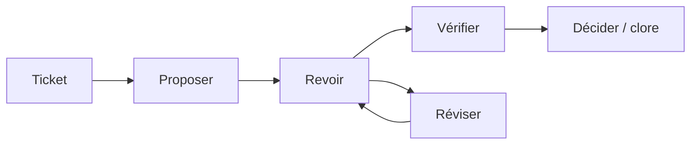
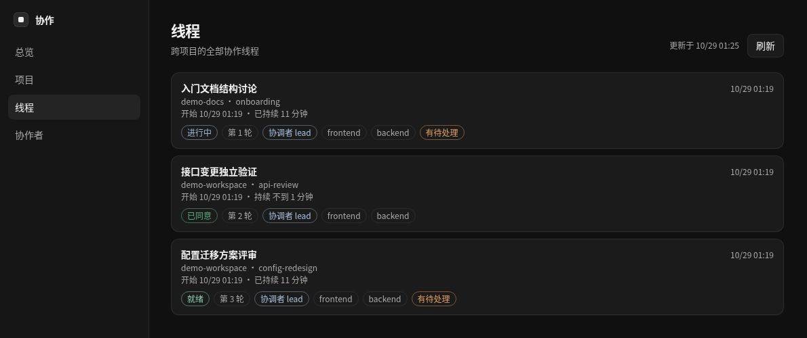
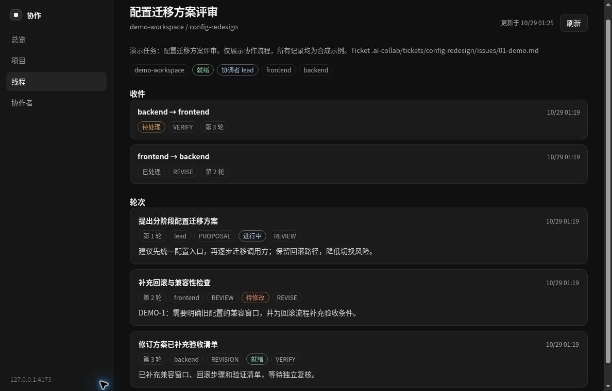

<a name="top"></a>

<h1 align="center">Agent Collaboration Skill</h1>

<p align="center"><strong>La collaboration multi-agents entre outils pour Codex, Claude Code, Cursor et d'autres agents de programmation IA.</strong></p>

<p align="center">
  <a href="LICENSE"></a>
  <a href="#readme-installation"></a>
</p>

<p align="center">
  <a href="README.md">English</a> · <a href="README.zh-CN.md">简体中文</a> · <a href="README.zh-TW.md">繁體中文</a> · <strong>Français</strong> · <a href="README.ko.md">한국어</a> · <a href="README.ja.md">日本語</a>
</p>

<p align="center">
  <a href="#readme-installation">Installation</a> · <a href="#readme-quick-start">Démarrage rapide</a> · <a href="#readme-workflow">Le déroulement d’une collaboration</a> · <a href="#readme-automatic-multi-round-collaboration">Automatisation</a> · <a href="#readme-local-web-ui">Interface web</a> · <a href="#readme-reference">Référence</a>
</p>

Une compétence et un protocole de fichiers indépendants des fournisseurs pour une collaboration durable entre agents de programmation IA et participants humains, au moyen de fichiers Markdown et JSON partagés plutôt que d'un service propre à un fournisseur. Le projet comprend une CLI Python, un exécuteur facultatif de réveil automatique et une interface web locale.

| **Historique durable** | **Transmissions fiables** | **Vos outils au choix** |
| :--- | :--- | :--- |
| Les tours Markdown immuables conservent la trace des décisions et des constats. | Signaux JSON, état par agent et publication atomique rendent les transmissions explicites et évitent les doublons. | Utilisez un dépôt partagé avec Codex, Claude Code, Cursor ou un autre agent. |

<details>
<summary>Pourquoi des fichiers plutôt qu’un autre service ?</summary>

### Pourquoi ce projet existe

Les outils de programmation IA conservent généralement leur propre état de conversation. Cela fragilise la collaboration entre outils : le contexte est copié manuellement, les retours peuvent être écrasés et des interrogations répétées peuvent entraîner le traitement du même message deux fois.

Ce projet fournit un petit protocole partagé fondé sur Markdown et JSON :

- des tours Markdown immuables préservent l'historique de collaboration ;
- des signaux JSON propres à chaque destinataire avertissent le participant suivant ;
- un état propre à chaque agent empêche les traitements en double ;
- des identifiants stables de constats permettent de suivre les problèmes relevés en revue d'un tour à l'autre ;
- la publication atomique empêche les signaux de pointer vers des artefacts incomplets ;
- les mécanismes d'interrogation périodique, hooks et planificateurs propres aux outils restent hors du protocole.

Aucune API de fournisseur ni aucun service en arrière-plan n'est nécessaire.

</details>

<a name="readme-installation"></a>

## Installation

### Prérequis

- un dépôt Git ou un système de fichiers partagé ;
- Python 3.9 ou une version ultérieure pour la CLI facultative ;
- un outil de programmation IA capable de lire Markdown et JSON ;
- un moyen de réveiller les agents : la commande fournie `collab.py watch` avec la CLI non interactive de chaque outil, ou une invite manuelle, un hook ou une tâche planifiée.

Le protocole lui-même ne met pas en place de surveillance en arrière-plan ; `collab.py watch` est un exécuteur facultatif qui remplit ce rôle.

### Configuration des outils

Clonez le dépôt :

```bash
git clone https://github.com/longligooo/agent-collaboration-skill.git
```

Pour les outils prenant nativement en charge les compétences, copiez le dépôt dans le répertoire des compétences de l'outil ou créez-y un lien vers le dépôt. Voici des emplacements courants :

```text
~/.codex/skills/agent-collaboration/
~/.claude/skills/agent-collaboration/
.claude/skills/agent-collaboration/
```

Pour Cursor ou les outils utilisant des instructions de projet, faites pointer une règle de projet ou une entrée de `AGENTS.md` vers `SKILL.md`. Ne conservez qu'une seule copie canonique du protocole. Consultez [Adaptateurs d'outils](references/tool-adapters.md) pour plus de détails.

<a name="readme-quick-start"></a>

## Démarrage rapide

### 1. Préparer la spécification et le ticket

<a name="readme-tickets"></a>

#### Tickets

Avant d'attribuer le travail, formalisez une exigence humaine sous forme de spécification et de tickets. Un même ensemble d'exigences peut donner lieu à plusieurs tickets, chacun définissant précisément un élément pouvant être accepté indépendamment. Ne commencez pas l'implémentation et n'ouvrez pas de fil de collaboration sans ticket correspondant au travail. Les tours restent immuables ; l'état des tickets peut changer. `collab.py` n'analyse pas les tickets. Consultez [Tickets](references/tickets.md). Ce dépôt les stocke sous `.scratch/<feature-slug>/`, comme indiqué dans [`.docs/agents/issue-tracker.md`](.docs/agents/issue-tracker.md).

### 2. Ouvrir un fil

Rédigez d'abord la spécification et le ticket. Initialisez ensuite un fil de collaboration depuis le dépôt cible. L'objectif désigne ce ticket :

Dans les commandes ci-dessous, `/path/to/agent-collaboration` désigne l'emplacement où vous avez installé cette compétence. Exécutez ces commandes depuis le dépôt sur lequel vous souhaitez faire travailler les agents.

```bash
python /path/to/agent-collaboration/scripts/collab.py init \
  --root . \
  --thread-id config-redesign \
  --topic "Configuration redesign" \
  --objective "Ticket .ai-collab/tickets/config-redesign/issues/01-migration-plan.md: agree on and verify the migration plan" \
  --coordinator lead \
  --participants lead frontend backend
```

`--topic` est le titre lisible, résumé dans la langue principale de la conversation. Une conversation en chinois utilise un sujet en chinois, par exemple `--topic "配置改造"`, tandis que `--thread-id` reste `config-redesign`. L'exemple ci-dessus est en anglais, car cette conversation se déroule en anglais.

Un nouveau collaborateur reçoit une seule invite de démarrage lui indiquant d'utiliser cette compétence dans ce fil. L'humain la colle dans la conversation du collaborateur, sauf si le coordinateur est un sous-agent de la session en cours : dans ce cas, l'agent qui a ouvert le fil la transmet. Un collaborateur qui utilise déjà la compétence ne reçoit pas d'invite de démarrage. L'humain lui indique simplement qu'un nouveau fil lui a été attribué.

Si le projet déclare une racine pour ses tickets, utilisez-la dans ce chemin.

### 3. Rédiger le premier tour

Créez le premier modèle de tour immuable :

```bash
python /path/to/agent-collaboration/scripts/collab.py new-turn \
  --root . \
  --thread-id config-redesign \
  --author lead \
  --role proposer \
  --kind PROPOSAL \
  --status OPEN \
  --requested-action REVIEW \
  --title "Configuration redesign proposal"
```

### 4. Publier le tour complété

Complétez le fichier Markdown généré, puis publiez-le :

```bash
python /path/to/agent-collaboration/scripts/collab.py publish \
  --root . \
  --thread-id config-redesign \
  --agent lead \
  --to frontend \
  --document .ai-collab/threads/config-redesign/turns/round-0001-from-lead-proposal.md
```

### 5. Inspecter la boîte du destinataire

Le destinataire inspecte sa boîte de réception avec :

```bash
python /path/to/agent-collaboration/scripts/collab.py inspect \
  --root . \
  --agent frontend
```

> [!IMPORTANT]
> Seule une décision `NEW` doit donner lieu à une réponse. Les décisions `EMPTY`, `DUPLICATE` et `INVALID` ne doivent entraîner ni création de fichiers ni modification du code métier. Les signaux terminaux doivent être traités selon l'action demandée d'accusé de réception ou de clôture.

<a name="readme-workflow"></a>

## Le déroulement d’une collaboration

Un exemple de boucle de revue : choisissez les types de tours adaptés à la tâche.



Utilisez-les lorsque Codex, Claude Code, Cursor ou un autre agent de programmation doit discuter d'une conception, contester une proposition, transmettre un travail d'implémentation, effectuer une revue, vérifier des résultats, consigner une décision ou clore une tâche à plusieurs tours au moyen d'un dépôt partagé.

<details>
<summary>Flux de travail et exemples</summary>

### Flux de travail pris en charge

- discussions sur les exigences et l'architecture ;
- propositions, contestations et révisions ;
- transmissions de travaux d'implémentation ;
- revues de plans, de code et de documents ;
- vérification indépendante ;
- décisions, accord, annulation et clôture.

Les types de tours canoniques sont `DISCUSSION`, `PROPOSAL`, `CHALLENGE`, `REVISION`, `IMPLEMENTATION`, `REVIEW`, `VERIFICATION`, `DECISION` et `CLOSURE`.

Cas d'utilisation typiques :

| Cas d'utilisation | Exemple |
| --- | --- |
| Discussion d'architecture | Demander à un agent de proposer une conception et à un autre d'en remettre en question les hypothèses avant de décider. |
| Transmission de l'implémentation et revue de code | Transmettre une implémentation, suivre les constats de revue au fil des révisions, puis vérifier les corrections. |
| Vérification indépendante | Demander à un autre agent de reproduire les résultats des tests ou de vérifier une affirmation à partir des éléments présents dans le dépôt. |

</details>

<a name="readme-automatic-multi-round-collaboration"></a>

## Collaboration automatique à plusieurs tours

Sans automatisation, quelqu'un doit dire à chaque agent « un nouveau message est en attente » après chaque tour. La commande `watch` s'en charge : elle examine la boîte de réception de chaque agent et lance la CLI non interactive du destinataire (`claude -p`, `codex exec`, `agent -p`, `gemini -p`, etc.) pour un cycle de traitement lorsqu'un signal est en attente. Chaque réponse crée le signal suivant ; le fil avance donc tour après tour jusqu'à ce qu'un agent publie `AGREED`, `CLOSED` ou `CANCELLED`.

```bash
# une fois par dépôt : choisir la commande de réveil de chaque participant
python /path/to/agent-collaboration/scripts/collab.py init-wake \
  --root . --bind lead=cursor --bind frontend=claude-code --bind backend=codex

# ouvrir le fil et publier le premier tour (manuellement ou en le demandant à un agent),
# puis laisser le processus de surveillance piloter les tours suivants
python /path/to/agent-collaboration/scripts/collab.py watch \
  --root . --thread-id config-redesign
```

Le processus de surveillance s'arrête lorsque le fil est terminé, lorsqu'un fichier `STOP` apparaît ou lorsqu'une limite de tours, de réveils ou de nouvelles tentatives est atteinte. La sortie des agents est écrite dans `.ai-collab/logs/`. Des participants sur des machines différentes peuvent partager un fil via Git avec `--agents backend --git-sync`. `--git-sync` ne publie que `.ai-collab/threads/`, et seul un humain peut l'activer. Les participants ne créent pas de commits du code produit, sauf demande explicite de l'humain. Examinez les permissions du fichier `.ai-collab/wake.json` généré avant une exécution sans supervision. Consultez [Adaptateurs d'outils](references/tool-adapters.md#automatic-wake-up-with-collabpy-watch) pour le format de configuration et les limites de sécurité.

<a name="readme-local-web-ui"></a>

## Interface web locale

Captures réelles de l’interface web locale fournie, alimentée par des projets et des tours de collaboration fictifs. L’interface actuelle est en chinois ; ces exemples ne sont pas des conversations exécutées par des agents externes.

**Fils de plusieurs projets : participants, travail en attente et différents états de collaboration.**



**Détail d’un fil : destinataires, état de la revue et historique de la proposition à la révision.**



L'interface web reste désactivée tant que personne n'exécute :

```bash
python scripts/collab.py ui --root .
```

Elle écoute sur `127.0.0.1:23451` sous Windows, macOS et Linux. La commande sonde d'abord ce port. Une seconde exécution enregistre le dépôt courant auprès de l'interface déjà en cours d'exécution. Ouvrez `http://127.0.0.1:23451/` pour voir tous les projets enregistrés, leurs fils et chaque participant dans les différents projets. La page ne s'actualise pas automatiquement ; utilisez 刷新 (« Actualiser »). La première version utilise un thème sombre. Ne la démarrez que lorsqu'un humain demande le service de collaboration en arrière-plan ou l'interface web.

Exécutez `python scripts/collab.py --help` pour consulter les options des commandes.

<a name="readme-reference"></a>

## Référence

| Point de départ | Usage |
| :--- | :--- |
| [SKILL.md](SKILL.md) | Flux de travail et règles de sécurité des agents |
| [references/protocol.md](references/protocol.md) | Protocole et implémentation des adaptateurs |
| [references/artifact-format.md](references/artifact-format.md) | Formats des tours, signaux, manifestes et états |
| [references/tool-adapters.md](references/tool-adapters.md) | Découverte des outils et configuration du réveil |
| [references/examples.md](references/examples.md) | Exemples de séquences de collaboration |
| [references/tickets.md](references/tickets.md) | Exigences des spécifications et des tickets |

<details>
<summary>Format de l'espace de travail</summary>

### Format de l'espace de travail

Chaque dépôt cible reçoit un espace de travail `.ai-collab` :

```text
.ai-collab/
  threads/<thread-id>/
    thread.json
    turns/round-<NNNN>-from-<agent>-<kind>.md
    signals/to-<agent>.json
    state/<agent>.json
```

Les tours sont la source de vérité. Les signaux sont des notifications remplaçables. Chaque agent n'écrit que son propre fichier d'état et ne modifie jamais les tours d'un autre participant.

Lisez [SKILL.md](SKILL.md) avant d'utiliser ce flux de travail, et le [Protocole](references/protocol.md) avant d'implémenter un adaptateur.

</details>

<details>
<summary>Commandes CLI</summary>

### Commandes CLI

```text
init               Créer un manifeste de fil immuable
new-turn           Créer un modèle de tour sans écraser de fichier existant
validate-artifact  Valider un tour complété
inspect            Inspecter la boîte de réception d'un agent
inbox              Quitter avec le code 0 si cet agent a un message, sinon avec le code 1
publish            Publier atomiquement le signal d'un tour
acknowledge        Marquer le signal courant comme traité
init-wake          Écrire un modèle de configuration de réveil pour la surveillance
watch              Réveiller automatiquement les agents lorsqu'un signal est en attente
ui                 Démarrer l'interface web locale ou seulement enregistrer ce dépôt
```

</details>

<details>
<summary>Contenu du dépôt</summary>

### Contenu du dépôt

```text
SKILL.md                       Instructions de travail destinées aux agents
agents/openai.yaml             Métadonnées facultatives pour l'interface Codex
references/protocol.md         Protocole de collaboration canonique
references/artifact-format.md  Formats des tours, signaux, manifestes et états
references/tool-adapters.md    Adaptateurs Codex, Claude Code, Cursor et génériques
references/examples.md         Exemples de séquences de collaboration
references/tickets.md          Format des spécifications et tickets ; requis avant attribution
.docs/agents/issue-tracker.md   Racine des tickets de ce dépôt
scripts/collab.py              CLI du protocole, utilisant la bibliothèque standard
scripts/ui_server.py           Serveur de l'interface web locale
scripts/adapters/              Appelants de `inbox` pour Cursor, Claude Code et ChatGPT
ui/                           Interface web locale sombre
tests/test_collab.py           Tests de non-régression de la CLI et du protocole
tests/test_watch.py            Tests du réveil automatique (watch)
tests/test_inbox.py            Requête commune de boîte de réception et scripts de réveil par outil
tests/test_ui.py               Registre, vues et démarrage à processus unique de l'interface web locale
```

</details>

<a name="readme-validation"></a>

## Validation

Lancez la suite de tests de non-régression :

```bash
python -m unittest discover -s tests -v
```

Les tests couvrent la publication, l'inspection, les accusés de réception, la détection des doublons, les signaux terminaux, les tours immuables, la sécurité des chemins du dépôt, l'identité des signaux et les exécutions sans supervision à plusieurs tours du processus de surveillance, y compris ses limites et la synchronisation Git.

<a name="readme-security-and-scope"></a>

## Sécurité et périmètre

> [!IMPORTANT]
> Une action de collaboration demandée ne constitue pas une autorisation supplémentaire. Les agents doivent toujours respecter le périmètre de la tâche de l'utilisateur et évaluer indépendamment les commandes avant de les exécuter. Ne placez aucun secret dans les tours, manifestes, signaux ou fichiers d'état.

<a name="readme-license"></a>

## Licence

Licence MIT. Consultez [LICENSE](LICENSE).

<p align="right"><a href="#top">Retour en haut ↑</a></p>
