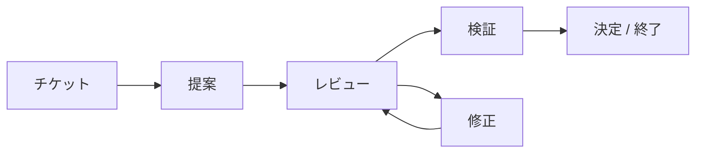

<a name="top"></a>

<h1 align="center">Agent Collaboration Skill</h1>

<p align="center"><strong>Codex、Claude Code、Cursor などの AI コーディングエージェントが、<br>ツールの垣根を越えて複数エージェントで協働するための仕組みです。</strong></p>

<p align="center">
  <a href="LICENSE"></a>
  <a href="#readme-installation"></a>
</p>

<p align="center">
  <a href="README.md">English</a> · <a href="README.zh-CN.md">简体中文</a> · <a href="README.zh-TW.md">繁體中文</a> · <a href="README.fr.md">Français</a> · <a href="README.ko.md">한국어</a> · <strong>日本語</strong>
</p>

<p align="center">
  <a href="#readme-installation">インストール</a> · <a href="#readme-quick-start">クイックスタート</a> · <a href="#readme-workflow">協働の流れ</a> · <a href="#readme-automatic-multi-round-collaboration">自動協働</a> · <a href="#readme-local-web-ui">Web UI</a> · <a href="#readme-reference">リファレンス</a>
</p>

AI コーディングエージェントと人間の参加者が、継続的かつ記録を残しながら協働するための、ベンダーに依存しないスキルとファイルプロトコルです。ベンダー固有のサービスではなく、共有の Markdown ファイルと JSON ファイルを使います。Python CLI、オプションの自動起動ランナー、ローカル Web UI が含まれています。

| **残り続ける協働の履歴** | **確実な引き継ぎ** | **自由なツール選択** |
| :--- | :--- | :--- |
| 変更不可の Markdown ターンで、決定とレビューの指摘を追跡できます。 | JSON シグナル、個別の状態、アトミックな公開で引き継ぎを明確にし、重複処理を防ぎます。 | 共有リポジトリで Codex、Claude Code、Cursor などのエージェントを使えます。 |

<details>
<summary>別のサービスではなくファイルを使う理由</summary>

### このプロジェクトの目的

AI コーディングツールは通常、それぞれ独自に会話の状態を保持します。そのため、ツールをまたぐ協働は不安定になりがちです。コンテキストを手作業でコピーする必要があり、フィードバックが上書きされたり、繰り返しのポーリングで同じメッセージが二重に処理されたりすることがあります。

このプロジェクトは、Markdown と JSON で構成する小さな共有プロトコルを提供します。

- 変更不可の Markdown ターンで協働の履歴を保持します。
- 受信者ごとの JSON シグナルで次の参加者に通知します。
- エージェントごとの状態で重複処理を防ぎます。
- 固定の指摘 ID でレビューの問題をラウンド間で引き継ぎます。
- アトミックな公開によって、未完成の成果物をシグナルが参照することを防ぎます。
- ツール固有のポーリング、フック、スケジューラーはプロトコルの外で扱います。

ベンダーの API やバックグラウンドサービスは不要です。

</details>

<a name="readme-installation"></a>

## インストール

### 必要なもの

- 共有 Git リポジトリまたはファイルシステム
- オプションの CLI を使う場合は Python 3.9 以降
- Markdown と JSON を読める AI コーディングツール
- エージェントを起動する手段：同梱の `collab.py watch` コマンドと各ツールの非対話型 CLI、または手動のプロンプト、フック、スケジュールされたジョブ

プロトコル自体はバックグラウンド監視を開始しません。`collab.py watch` は、その機能を担うオプションのランナーです。

### ツールの設定

リポジトリをクローンします。

```bash
git clone https://github.com/longligooo/agent-collaboration-skill.git
```

スキルをネイティブにサポートするツールでは、リポジトリをそのツールのスキルディレクトリにコピーするか、リンクを作成します。よく使われる場所は次のとおりです。

```text
~/.codex/skills/agent-collaboration/
~/.claude/skills/agent-collaboration/
.claude/skills/agent-collaboration/
```

Cursor など、プロジェクトの指示を使うツールでは、プロジェクトルールまたは `AGENTS.md` の項目から `SKILL.md` を参照するようにします。プロトコルの正本は 1 つだけにしてください。詳しくは[ツールアダプター](references/tool-adapters.md)を参照してください。

<a name="readme-quick-start"></a>

## クイックスタート

### 1. 仕様とチケットを準備

<a name="readme-tickets"></a>

#### チケット

作業を割り当てる前に、人間の要件を仕様書とチケットにまとめます。1 回の要件提示から複数のチケットを作成しても構いませんが、各チケットで確定するのは、単独で受け入れ判定できる 1 件の事項です。その作業に対応するチケットなしに、実装を開始したり、協働スレッドを開いたりしてはいけません。ターンは変更不可ですが、チケットのステータスは変更できます。`collab.py` はチケットを解析しません。[チケット](references/tickets.md)を参照してください。このリポジトリでは、[`.docs/agents/issue-tracker.md`](.docs/agents/issue-tracker.md) の宣言に従い、`.scratch/<feature-slug>/` 以下に保存します。

### 2. スレッドを作成

まず仕様書とチケットを書きます。その後、対象リポジトリで協働スレッドを初期化します。目的には、そのチケットを明記します。

以下の `/path/to/agent-collaboration` は、このスキルをインストールした場所を指します。コマンドは、エージェントに作業させたいリポジトリから実行してください。

```bash
python /path/to/agent-collaboration/scripts/collab.py init \
  --root . \
  --thread-id config-redesign \
  --topic "Configuration redesign" \
  --objective "Ticket .ai-collab/tickets/config-redesign/issues/01-migration-plan.md: agree on and verify the migration plan" \
  --coordinator lead \
  --participants lead frontend backend
```

`--topic` は人が読めるタイトルで、会話の主な言語で要約します。中国語の会話なら、例えば `--topic "配置改造"` のように中国語のトピックを使い、`--thread-id` は `config-redesign` のままにします。上の例は、想定する会話が英語なので英語になっています。

新しい協働者には、そのスレッドでこのスキルを使うよう伝える導入プロンプトを 1 つ渡します。人間が協働者のチャットに貼り付けますが、コーディネーターが現在のセッションのサブエージェントである場合は、スレッドを開始したエージェントが届けます。すでにこのスキルを使っている協働者には導入プロンプトを渡しません。人間が新しいスレッドを割り当てたことだけを伝えます。

プロジェクトでチケットルートが宣言されている場合は、上記のパスにそのルートを使います。

### 3. 最初のターンを記述

最初の変更不可のターンテンプレートを作成します。

```bash
python /path/to/agent-collaboration/scripts/collab.py new-turn \
  --root . \
  --thread-id config-redesign \
  --author lead \
  --role proposer \
  --kind PROPOSAL \
  --status OPEN \
  --requested-action REVIEW \
  --title "Configuration redesign proposal"
```

### 4. 完成したターンを公開

生成された Markdown ファイルを完成させてから、公開します。

```bash
python /path/to/agent-collaboration/scripts/collab.py publish \
  --root . \
  --thread-id config-redesign \
  --agent lead \
  --to frontend \
  --document .ai-collab/threads/config-redesign/turns/round-0001-from-lead-proposal.md
```

### 5. 受信者の受信箱を確認

受信者は次のコマンドで自分の受信箱を確認します。

```bash
python /path/to/agent-collaboration/scripts/collab.py inspect \
  --root . \
  --agent frontend
```

> [!IMPORTANT]
> 応答を作成してよいのは、判定が `NEW` の場合だけです。`EMPTY`、`DUPLICATE`、`INVALID` の場合は、ファイルを作成したり、業務コードを変更したりしてはいけません。終端シグナルでは、要求された受領確認または終了処理に従う必要があります。

<a name="readme-workflow"></a>

## 協働の流れ

レビューを繰り返す流れの一例です。固定の手順ではなく、タスクに合うターンの種類を選んでください。



Codex、Claude Code、Cursor などのコーディングエージェントが、共有リポジトリを通じて設計の議論、提案への異議提示、実装の引き継ぎ、作業のレビュー、結果の検証、決定の記録、複数ラウンドにわたるタスクの終了を行う際に使います。

<details>
<summary>対応ワークフローと使用例</summary>

### 対応するワークフロー

- 要件とアーキテクチャの議論
- 提案、異議提示、改訂
- 実装の引き継ぎ
- 計画、コード、文書のレビュー
- 独立した検証
- 決定、合意、キャンセル、終了

正式なターン種別は `DISCUSSION`、`PROPOSAL`、`CHALLENGE`、`REVISION`、`IMPLEMENTATION`、`REVIEW`、`VERIFICATION`、`DECISION`、`CLOSURE` です。

主な使用例：

| 使用場面 | 例 |
| --- | --- |
| アーキテクチャの議論 | あるエージェントに設計を提案させ、別のエージェントにその前提を問い直させてから決定します。 |
| 実装の引き継ぎとコードレビュー | 実装を引き継ぎ、改訂を重ねながらレビューの指摘事項を追跡し、最後に修正を検証します。 |
| 独立した検証 | 別のエージェントにテスト結果の再現や、リポジトリ内の根拠に照らした主張の確認を依頼します。 |

</details>

<a name="readme-automatic-multi-round-collaboration"></a>

## 複数ラウンドの自動協働

自動化しない場合、各ターンの後に誰かが各エージェントへ「新しいメッセージがあります」と伝える必要があります。`watch` コマンドがこれを代行します。各エージェントの受信箱を調べ、シグナルが待機していると、受信者の非対話型 CLI（`claude -p`、`codex exec`、`agent -p`、`gemini -p` など）を 1 処理サイクル分実行します。返信するたびに次のシグナルが作成されるため、いずれかのエージェントが `AGREED`、`CLOSED`、`CANCELLED` を公開するまで、スレッドはラウンドごとに進みます。

```bash
# リポジトリごとに一度、各参加者の起動コマンドを選択する
python /path/to/agent-collaboration/scripts/collab.py init-wake \
  --root . --bind lead=cursor --bind frontend=claude-code --bind backend=codex

# スレッドを開いて最初のターンを公開する（手動、または任意のエージェントに依頼）
# その後はウォッチャーに残りのラウンドを進めさせる
python /path/to/agent-collaboration/scripts/collab.py watch \
  --root . --thread-id config-redesign
```

ウォッチャーは、スレッドの終了時、`STOP` ファイルの出現時、またはラウンド数、起動回数、再試行回数の上限に達したときに停止します。エージェントの出力は `.ai-collab/logs/` に書き込まれます。異なるマシン上の参加者は、`--agents backend --git-sync` を指定することで、Git を通じてスレッドを共有できます。`--git-sync` が公開するのは `.ai-collab/threads/` だけで、有効にできるのは人間だけです。人間が明示的に依頼しない限り、参加者は製品コードをコミットしません。無人で実行する前に、生成された `.ai-collab/wake.json` の権限を確認してください。設定形式と安全上の制限については、[ツールアダプター](references/tool-adapters.md#automatic-wake-up-with-collabpy-watch)を参照してください。

<a name="readme-local-web-ui"></a>

## ローカル Web UI

付属のローカル Web UI を実際に起動し、架空のデモプロジェクトと協働ターンを入れて撮影した画面です。現在の UI は中国語です。外部エージェントを実行して生成した会話ではありません。

**プロジェクトをまたぐスレッド：参加者、保留中の作業、各タスクの状態を一覧できます。**


**スレッド詳細：受信者、レビュー状況、提案から修正までの履歴を確認できます。**


次のコマンドを実行するまで、Web UI は起動しません。

```bash
python scripts/collab.py ui --root .
```

Windows、macOS、Linux で `127.0.0.1:23451` にバインドします。コマンドは最初にそのポートを確認します。2 回目の実行では、すでに動作している UI に現在のリポジトリを登録します。`http://127.0.0.1:23451/` を開くと、登録されたすべてのプロジェクト、そのスレッド、プロジェクトをまたいだ各参加者を確認できます。ページは自動更新されません。「刷新」（更新）を使ってください。初版はダークテーマです。人間が協働用のバックグラウンド処理または Web UI の起動を求めた場合にだけ起動してください。

コマンドのオプションは `python scripts/collab.py --help` で確認できます。

<a name="readme-reference"></a>

## リファレンス

| 読むドキュメント | 用途 |
| :--- | :--- |
| [SKILL.md](SKILL.md) | エージェントのワークフローと安全ルール |
| [references/protocol.md](references/protocol.md) | プロトコルとアダプターの実装 |
| [references/artifact-format.md](references/artifact-format.md) | ターン、シグナル、マニフェスト、状態の形式 |
| [references/tool-adapters.md](references/tool-adapters.md) | ツールの検出と自動起動の設定 |
| [references/examples.md](references/examples.md) | 協働シーケンスの例 |
| [references/tickets.md](references/tickets.md) | 仕様とチケットの要件 |

<details>
<summary>ワークスペースの形式</summary>

### ワークスペースの形式

各対象リポジトリに `.ai-collab` ワークスペースが作成されます。

```text
.ai-collab/
  threads/<thread-id>/
    thread.json
    turns/round-<NNNN>-from-<agent>-<kind>.md
    signals/to-<agent>.json
    state/<agent>.json
```

ターンが正本です。シグナルは置き換え可能な通知です。各エージェントは自分の状態ファイルだけを書き込み、他の参加者のターンは決して編集しません。

ワークフローを使う前に [SKILL.md](SKILL.md) を、アダプターを実装する前に[プロトコル](references/protocol.md)を読んでください。

</details>

<details>
<summary>CLI コマンド</summary>

### CLI コマンド

```text
init               変更不可のスレッドマニフェストを作成する
new-turn           既存ファイルを上書きしないターンテンプレートを作成する
validate-artifact  完成したターンを検証する
inspect            1 つのエージェントの受信箱を確認する
inbox              このエージェント宛てのメールがあれば終了コード 0、なければ 1
publish            ターンのシグナルをアトミックに公開する
acknowledge        現在のシグナルを処理済みとして記録する
init-wake          ウォッチャー用の起動設定テンプレートを書き込む
watch              シグナルが待機しているときにエージェントを自動起動する
ui                 ローカル Web UI を起動する、またはこのリポジトリを登録するだけにする
```

</details>

<details>
<summary>リポジトリの構成</summary>

### リポジトリの構成

```text
SKILL.md                       エージェント向けのワークフロー手順
agents/openai.yaml             任意の Codex UI メタデータ
references/protocol.md         協働プロトコルの正本
references/artifact-format.md  ターン、シグナル、マニフェスト、状態の形式
references/tool-adapters.md    Codex、Claude Code、Cursor および汎用アダプター
references/examples.md         協働シーケンスの例
references/tickets.md          仕様書とチケットの形式。作業割り当て前に必須
.docs/agents/issue-tracker.md   このリポジトリのチケットルート
scripts/collab.py              標準ライブラリのみを使うプロトコル CLI
scripts/ui_server.py           ローカル Web UI サーバー
scripts/adapters/              Cursor、Claude Code、ChatGPT から `inbox` を呼び出す仕組み
ui/                            ダークテーマのローカル Web UI
tests/test_collab.py           CLI とプロトコルの回帰テスト
tests/test_watch.py            自動起動（watch）のテスト
tests/test_inbox.py            共通の受信箱クエリとツール別の起動スクリプト
tests/test_ui.py               ローカル Web UI の登録、表示、単一プロセス起動
```

</details>

<a name="readme-validation"></a>

## 検証

回帰テストスイートを実行します。

```bash
python -m unittest discover -s tests -v
```

テストは、公開、受信箱の確認、受領確認、重複検出、終端シグナル、変更不可のラウンド、安全なリポジトリパス、シグナルの同一性、そしてウォッチャーの無人での複数ラウンド実行を対象とし、制限と Git 同期も含みます。

<a name="readme-security-and-scope"></a>

## セキュリティと作業範囲

> [!IMPORTANT]
> 協働アクションの依頼は、追加の権限を与えるものではありません。エージェントは引き続きユーザーのタスク範囲を守り、コマンドを実行する前に独立して評価する必要があります。ターン、マニフェスト、シグナル、状態ファイルに秘密情報を保存してはいけません。

<a name="readme-license"></a>

## ライセンス

MIT License。[LICENSE](LICENSE) を参照してください。

<p align="right"><a href="#top">先頭に戻る ↑</a></p>
