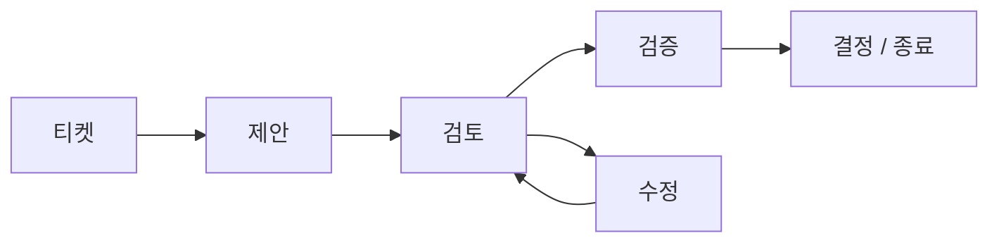

<a id="top"></a>

<h1 align="center">Agent Collaboration Skill</h1>

<p align="center"><strong>Codex, Claude Code, Cursor 등의 AI 코딩 에이전트를 위한, 도구 간 멀티 에이전트 협업 방식입니다.</strong></p>

<p align="center">
  <a href="LICENSE"></a>
  <a href="#readme-installation"></a>
</p>

<p align="center">
  <a href="README.md">English</a> · <a href="README.zh-CN.md">简体中文</a> · <a href="README.zh-TW.md">繁體中文</a> · <a href="README.fr.md">Français</a> · <strong>한국어</strong> · <a href="README.ja.md">日本語</a>
</p>

<p align="center">
  <a href="#readme-installation">설치</a> · <a href="#readme-quick-start">빠른 시작</a> · <a href="#readme-workflow">협업 진행 흐름</a> · <a href="#readme-automatic-multi-round-collaboration">자동 협업</a> · <a href="#readme-reference">참고 자료</a>
</p>

AI 코딩 에이전트와 사람이 지속적으로 협업하고 기록을 남길 수 있도록 하는, 특정 공급업체에 종속되지 않는 스킬과 파일 프로토콜입니다. 공급업체 전용 서비스 대신 공유 Markdown 및 JSON 파일을 사용합니다. Python CLI, 에이전트를 자동으로 깨우는 선택적 실행기, 로컬 웹 UI를 포함합니다.

| **지속되는 협업 이력** | **신뢰할 수 있는 인계** | **자유로운 도구 선택** |
| :--- | :--- | :--- |
| 변경 불가능한 Markdown 턴으로 결정과 검토 지적 사항을 추적합니다. | JSON 신호, 에이전트별 상태, 원자적 게시로 인계를 명확히 하고 중복 처리를 방지합니다. | 공유 저장소에서 Codex, Claude Code, Cursor 또는 다른 에이전트를 사용합니다. |

<details>
<summary>별도 서비스 대신 파일을 사용하는 이유</summary>

### 이 프로젝트가 필요한 이유

AI 코딩 도구는 일반적으로 각자의 대화 상태를 유지합니다. 이 때문에 도구 간 협업이 불안정해지기 쉽습니다. 맥락을 수동으로 복사해야 하고, 피드백이 덮어써질 수 있으며, 반복 폴링 과정에서 같은 메시지를 두 번 처리할 수도 있습니다.

이 프로젝트는 Markdown과 JSON으로 구성된 작은 공유 프로토콜을 제공합니다.

- 변경 불가능한 Markdown 턴으로 협업 이력을 보존합니다.
- 수신자별 JSON 신호로 다음 참여자에게 알립니다.
- 에이전트별 상태로 중복 처리를 방지합니다.
- 고정된 지적 사항 ID로 검토 중 발견한 문제를 라운드 간에 이어 갑니다.
- 원자적 게시를 통해 신호가 미완성 산출물을 가리키지 않도록 합니다.
- 도구별 폴링, 훅, 스케줄러는 프로토콜 외부에서 다룹니다.

공급업체 API나 백그라운드 서비스가 필요하지 않습니다.

</details>

<a id="readme-installation"></a>

## 설치

### 요구 사항

- 공유 Git 저장소 또는 파일 시스템
- 선택 사항인 CLI를 사용하려면 Python 3.9 이상
- Markdown과 JSON을 읽을 수 있는 AI 코딩 도구
- 에이전트를 깨우는 방법: 함께 제공되는 `collab.py watch` 명령과 각 도구의 비대화형 CLI, 또는 수동 프롬프트, 훅, 예약 작업

프로토콜 자체는 백그라운드 모니터링을 시작하지 않습니다. `collab.py watch`는 이 기능을 제공하는 선택적 실행기입니다.

### 도구 설정

저장소를 복제합니다.

```bash
git clone https://github.com/longligooo/agent-collaboration-skill.git
```

스킬을 기본 지원하는 도구에서는 저장소를 해당 도구의 스킬 디렉터리에 복사하거나 링크합니다. 일반적으로 다음 위치를 사용합니다.

```text
~/.codex/skills/agent-collaboration/
~/.claude/skills/agent-collaboration/
.claude/skills/agent-collaboration/
```

Cursor 또는 프로젝트 지침을 사용하는 도구에서는 프로젝트 규칙이나 `AGENTS.md` 항목이 `SKILL.md`를 가리키도록 합니다. 프로토콜의 기준 사본은 하나만 유지하세요. 자세한 내용은 [도구 어댑터](references/tool-adapters.md)를 참고하세요.

<a id="readme-quick-start"></a>

## 빠른 시작

### 1. 명세와 티켓 준비

<a id="readme-tickets"></a>

#### 티켓

작업을 배정하기 전에 사람이 제시한 요구 사항을 명세와 티켓으로 작성합니다. 한 차례의 요구 사항을 여러 티켓으로 나눌 수 있으며, 각 티켓은 독립적으로 인수 여부를 판단할 수 있는 한 가지 사항만 확정합니다. 해당 작업의 티켓 없이 구현을 시작하거나 협업 스레드를 열어서는 안 됩니다. 턴은 변경할 수 없지만 티켓 상태는 변경할 수 있습니다. `collab.py`는 티켓을 파싱하지 않습니다. [티켓](references/tickets.md)을 참고하세요. 이 저장소는 [`.docs/agents/issue-tracker.md`](.docs/agents/issue-tracker.md)의 선언에 따라 `.scratch/<feature-slug>/` 아래에 티켓을 저장합니다.

### 2. 스레드 생성

먼저 명세와 티켓을 작성합니다. 그런 다음 대상 저장소에서 협업 스레드를 초기화합니다. 목표에는 해당 티켓을 명시합니다.

아래의 `/path/to/agent-collaboration`은 이 스킬을 설치한 위치를 뜻합니다. 에이전트가 작업할 저장소에서 이 명령들을 실행하세요.

```bash
python /path/to/agent-collaboration/scripts/collab.py init \
  --root . \
  --thread-id config-redesign \
  --topic "Configuration redesign" \
  --objective "Ticket .ai-collab/tickets/config-redesign/issues/01-migration-plan.md: agree on and verify the migration plan" \
  --coordinator lead \
  --participants lead frontend backend
```

`--topic`은 사람이 읽을 수 있는 제목으로, 대화의 주 언어로 요약합니다. 중국어 대화에서는 예를 들어 `--topic "配置改造"`처럼 중국어 주제를 사용하되, `--thread-id`는 `config-redesign`으로 유지합니다. 위 예제가 영어인 이유는 해당 예제의 대화가 영어이기 때문입니다.

새 협업자에게는 해당 스레드에서 이 스킬을 사용하도록 안내하는 시작 프롬프트 하나를 전달합니다. 사람이 협업자의 채팅에 붙여 넣습니다. 단, 조정자가 현재 세션의 하위 에이전트인 경우에는 스레드를 시작한 에이전트가 전달합니다. 이미 이 스킬을 사용하는 협업자에게는 시작 프롬프트를 주지 않습니다. 사람은 새 스레드가 배정되었다는 사실만 알려 줍니다.

프로젝트에 선언된 티켓 루트가 있으면 해당 경로에 그 루트를 사용합니다.

### 3. 첫 번째 턴 작성

첫 번째 변경 불가능한 턴 템플릿을 만듭니다.

```bash
python /path/to/agent-collaboration/scripts/collab.py new-turn \
  --root . \
  --thread-id config-redesign \
  --author lead \
  --role proposer \
  --kind PROPOSAL \
  --status OPEN \
  --requested-action REVIEW \
  --title "Configuration redesign proposal"
```

### 4. 완성된 턴 게시

생성된 Markdown 파일을 완성한 다음 게시합니다.

```bash
python /path/to/agent-collaboration/scripts/collab.py publish \
  --root . \
  --thread-id config-redesign \
  --agent lead \
  --to frontend \
  --document .ai-collab/threads/config-redesign/turns/round-0001-from-lead-proposal.md
```

### 5. 수신자의 받은 편지함 확인

수신자는 다음 명령으로 자신의 수신함을 확인합니다.

```bash
python /path/to/agent-collaboration/scripts/collab.py inspect \
  --root . \
  --agent frontend
```

> [!IMPORTANT]
> 판정이 `NEW`인 경우에만 응답을 생성해야 합니다. `EMPTY`, `DUPLICATE`, `INVALID` 판정에서는 파일을 생성하거나 비즈니스 코드를 수정해서는 안 됩니다. 종료 신호에는 요청된 수신 확인 또는 종료 동작을 따라야 합니다.

<a id="readme-workflow"></a>

## 협업 진행 흐름

검토 반복 과정의 한 예입니다. 고정된 절차가 아니라 작업에 맞는 턴 종류를 선택하세요.



Codex, Claude Code, Cursor 등의 코딩 에이전트가 공유 저장소를 통해 설계를 논의하거나, 제안에 이의를 제기하거나, 구현을 인계하거나, 작업을 검토하거나, 결과를 검증하거나, 결정을 기록하거나, 여러 라운드에 걸친 작업을 마무리해야 할 때 사용합니다.

<details>
<summary>지원 워크플로와 예제</summary>

### 지원하는 워크플로

- 요구 사항 및 아키텍처 논의
- 제안, 이의 제기, 수정
- 구현 인계
- 계획, 코드, 문서 검토
- 독립적인 검증
- 결정, 합의, 취소, 종료

공식 턴 유형은 `DISCUSSION`, `PROPOSAL`, `CHALLENGE`, `REVISION`, `IMPLEMENTATION`, `REVIEW`, `VERIFICATION`, `DECISION`, `CLOSURE`입니다.

대표적인 사용 사례:

| 사용 사례 | 예시 |
| --- | --- |
| 아키텍처 논의 | 한 에이전트가 설계를 제안하고 다른 에이전트가 그 전제에 이의를 제기하도록 한 뒤 결정합니다. |
| 구현 인계 및 코드 검토 | 구현을 인계하고, 수정 과정 전반에서 검토 지적 사항을 추적한 다음 수정 결과를 검증합니다. |
| 독립적인 검증 | 다른 에이전트에게 테스트 결과를 재현하거나 저장소의 근거와 대조하여 주장을 확인하도록 요청합니다. |

</details>

<a id="readme-automatic-multi-round-collaboration"></a>

## 여러 라운드의 자동 협업

자동화하지 않으면 매 턴이 끝날 때마다 누군가 각 에이전트에게 "새 메시지가 대기 중입니다"라고 알려야 합니다. `watch` 명령이 이 역할을 대신합니다. 각 에이전트의 수신함을 살피고, 신호가 대기 중이면 수신자의 비대화형 CLI(`claude -p`, `codex exec`, `agent -p`, `gemini -p` 등)를 한 번의 처리 주기 동안 실행합니다. 각 응답이 다음 신호를 만들므로, 에이전트가 `AGREED`, `CLOSED`, `CANCELLED` 중 하나를 게시할 때까지 스레드가 라운드별로 진행됩니다.

```bash
# 저장소마다 한 번: 각 참여자를 깨울 명령을 선택합니다
python /path/to/agent-collaboration/scripts/collab.py init-wake \
  --root . --bind lead=cursor --bind frontend=claude-code --bind backend=codex

# 스레드를 열고 첫 턴을 게시합니다(수동으로 또는 임의의 에이전트에게 요청)
# 이후에는 감시기가 나머지 라운드를 진행하게 합니다
python /path/to/agent-collaboration/scripts/collab.py watch \
  --root . --thread-id config-redesign
```

감시기는 스레드가 끝나거나, `STOP` 파일이 생기거나, 라운드 수, 실행 횟수 또는 재시도 횟수 제한에 도달하면 멈춥니다. 에이전트 출력은 `.ai-collab/logs/`에 기록됩니다. 서로 다른 컴퓨터의 참여자는 `--agents backend --git-sync`를 사용하여 Git을 통해 스레드를 공유할 수 있습니다. `--git-sync`는 `.ai-collab/threads/`만 게시하며, 사람만 이 기능을 켤 수 있습니다. 사람이 명시적으로 요청하지 않는 한 참여자는 제품 코드를 커밋하지 않습니다. 무인 실행 전에 생성된 `.ai-collab/wake.json`의 권한을 검토하세요. 설정 형식과 안전 제한은 [도구 어댑터](references/tool-adapters.md#automatic-wake-up-with-collabpy-watch)를 참고하세요.

<a id="readme-local-web-ui"></a>

## 로컬 웹 UI

다음 명령을 실행하기 전까지 웹 UI는 꺼져 있습니다.

```bash
python scripts/collab.py ui --root .
```

Windows, macOS, Linux에서 `127.0.0.1:23451`에 바인딩됩니다. 명령은 먼저 해당 포트를 확인합니다. 두 번째로 실행하면 이미 실행 중인 UI에 현재 저장소를 등록합니다. `http://127.0.0.1:23451/`을 열면 등록된 모든 프로젝트, 각 프로젝트의 스레드, 여러 프로젝트에 걸친 각 참여자를 볼 수 있습니다. 페이지는 자동으로 새로 고쳐지지 않으므로 刷新(새로 고침)을 사용하세요. 첫 버전은 다크 테마입니다. 사람이 협업용 백그라운드 프로세스 또는 웹 UI의 시작을 요청한 경우에만 실행하세요.

명령 옵션은 `python scripts/collab.py --help`로 확인할 수 있습니다.

<a id="readme-reference"></a>

## 참고 자료

| 읽을 문서 | 용도 |
| :--- | :--- |
| [SKILL.md](SKILL.md) | 에이전트 워크플로와 안전 규칙 |
| [references/protocol.md](references/protocol.md) | 프로토콜 및 어댑터 구현 |
| [references/artifact-format.md](references/artifact-format.md) | 턴, 신호, 매니페스트 및 상태 형식 |
| [references/tool-adapters.md](references/tool-adapters.md) | 도구 탐색과 깨우기 설정 |
| [references/examples.md](references/examples.md) | 협업 순서 예제 |
| [references/tickets.md](references/tickets.md) | 명세 및 티켓 요구 사항 |

<details>
<summary>작업 공간 형식</summary>

### 작업 공간 형식

각 대상 저장소에는 `.ai-collab` 작업 공간이 생성됩니다.

```text
.ai-collab/
  threads/<thread-id>/
    thread.json
    turns/round-<NNNN>-from-<agent>-<kind>.md
    signals/to-<agent>.json
    state/<agent>.json
```

턴이 기준이 되는 원본 기록입니다. 신호는 교체 가능한 알림입니다. 각 에이전트는 자신의 상태 파일만 작성하며, 다른 참여자의 턴은 절대로 수정하지 않습니다.

워크플로를 사용하기 전에 [SKILL.md](SKILL.md)를, 어댑터를 구현하기 전에 [프로토콜](references/protocol.md)을 읽으세요.

</details>

<details>
<summary>CLI 명령</summary>

### CLI 명령

```text
init               변경 불가능한 스레드 매니페스트 생성
new-turn           기존 파일을 덮어쓰지 않는 턴 템플릿 생성
validate-artifact  완성된 턴 검증
inspect            한 에이전트의 수신함 확인
inbox              이 에이전트에게 메시지가 있으면 종료 코드 0, 없으면 1
publish            턴 신호를 원자적으로 게시
acknowledge        현재 신호를 처리 완료로 표시
init-wake          감시기용 실행 설정 템플릿 작성
watch              신호가 대기 중일 때마다 에이전트 자동 실행
ui                 로컬 웹 UI 시작 또는 이 저장소만 등록
```

</details>

<details>
<summary>저장소 구성</summary>

### 저장소 구성

```text
SKILL.md                       에이전트용 워크플로 지침
agents/openai.yaml             선택적 Codex UI 메타데이터
references/protocol.md         협업 프로토콜의 기준 문서
references/artifact-format.md  턴, 신호, 매니페스트, 상태 형식
references/tool-adapters.md    Codex, Claude Code, Cursor 및 범용 어댑터
references/examples.md         협업 진행 순서 예제
references/tickets.md          명세와 티켓 형식; 작업 배정 전 필수
.docs/agents/issue-tracker.md   이 저장소의 티켓 루트
scripts/collab.py              표준 라이브러리만 사용하는 프로토콜 CLI
scripts/ui_server.py           로컬 웹 UI 서버
scripts/adapters/              Cursor, Claude Code, ChatGPT에서 `inbox`를 호출하는 도구
ui/                            다크 테마의 로컬 웹 UI
tests/test_collab.py           CLI 및 프로토콜 회귀 테스트
tests/test_watch.py            자동 실행(watch) 테스트
tests/test_inbox.py            공통 수신함 조회 및 도구별 실행 스크립트
tests/test_ui.py               로컬 웹 UI 등록, 화면, 단일 프로세스 시작
```

</details>

<a id="readme-validation"></a>

## 검증

회귀 테스트 모음을 실행합니다.

```bash
python -m unittest discover -s tests -v
```

테스트는 게시, 수신함 확인, 수신 확인, 중복 감지, 종료 신호, 변경 불가능한 라운드, 안전한 저장소 경로, 신호 식별, 감시기의 무인 다중 라운드 실행을 다루며, 감시기의 제한과 Git 동기화도 포함합니다.

<a id="readme-security-and-scope"></a>

## 보안 및 작업 범위

> [!IMPORTANT]
> 협업 동작에 대한 요청이 추가 권한을 부여하는 것은 아닙니다. 에이전트는 여전히 사용자의 작업 범위를 준수하고 실행 전에 명령을 독립적으로 평가해야 합니다. 턴, 매니페스트, 신호 또는 상태 파일에 비밀 정보를 넣지 마세요.

<a id="readme-license"></a>

## 라이선스

MIT License. [LICENSE](LICENSE)를 참고하세요.

<p align="right"><a href="#top">맨 위로 ↑</a></p>
