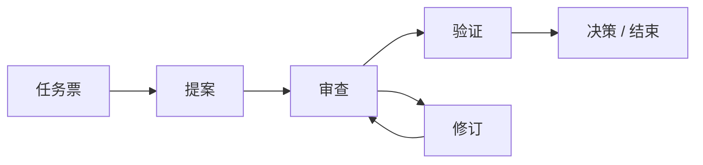

<a id="top"></a>

<h1 align="center">Agent Collaboration Skill</h1>

<p align="center"><strong>面向 Codex、Claude Code、Cursor 及其他 AI 编程智能体的跨工具、多智能体协作。</strong></p>

<p align="center">
  <a href="LICENSE"></a>
  <a href="#readme-installation"></a>
</p>

<p align="center">
  <a href="README.md">English</a> · <strong>简体中文</strong> · <a href="README.zh-TW.md">繁體中文</a> · <a href="README.fr.md">Français</a> · <a href="README.ko.md">한국어</a> · <a href="README.ja.md">日本語</a>
</p>

<p align="center">
  <a href="#readme-installation">安装</a> · <a href="#readme-quick-start">快速开始</a> · <a href="#readme-workflow">协作如何流转</a> · <a href="#readme-automatic-multi-round-collaboration">自动协作</a> · <a href="#readme-reference">参考资料</a>
</p>

一套不依赖特定厂商的技能与文件协议，通过共享的 Markdown 和 JSON 文件，而不是厂商专有服务，让 AI 编程智能体与人类参与者开展持久、可追溯的协作。提供 Python CLI、可选的自动唤醒运行器和本地 Web UI。

| **可追溯的历史** | **可靠的交接** | **工具自由组合** |
| :--- | :--- | :--- |
| 不可修改的 Markdown 回合，让决策和审查发现有据可查。 | JSON 信号、独立状态与原子发布，让交接明确、重复检查不重复执行。 | 在共享仓库中使用 Codex、Claude Code、Cursor 或其他智能体。 |

<details>
<summary>为什么选择文件，而不是另一个服务？</summary>

### 为什么需要这个项目

AI 编程工具通常各自保存对话状态，这使跨工具协作变得脆弱：上下文需要手动复制，反馈可能被覆盖，反复轮询还可能重复处理同一条消息。

本项目提供了一套由 Markdown 和 JSON 构成的轻量共享协议：

- 不可修改的 Markdown 回合文件保留协作历史；
- 按接收者分别存放的 JSON 信号通知下一位参与者；
- 每个智能体独立的状态防止重复处理；
- 稳定的问题发现 ID 让审查问题能够跨回合追踪；
- 原子发布避免信号指向尚未完成的产物；
- 特定工具的轮询、钩子和调度器不属于协议本身。

无需厂商 API 或后台服务。

</details>

<a id="readme-installation"></a>

## 安装

### 环境要求

- 共享的 Git 仓库或文件系统；
- 如需使用可选 CLI，需安装 Python 3.9 或更高版本；
- 能读取 Markdown 和 JSON 的 AI 编程工具；
- 唤醒智能体的方式：使用随附的 `collab.py watch` 命令配合各工具的非交互式 CLI，或使用手动提示、钩子或定时任务。

协议本身不会创建后台监控；可选的 `collab.py watch` 运行器提供这项能力。

### 工具配置

克隆仓库：

```bash
git clone https://github.com/longligooo/agent-collaboration-skill.git
```

对于原生支持技能的工具，将仓库复制或链接到该工具的技能目录。常见位置包括：

```text
~/.codex/skills/agent-collaboration/
~/.claude/skills/agent-collaboration/
.claude/skills/agent-collaboration/
```

对于 Cursor 或使用项目指令的工具，在项目规则或 `AGENTS.md` 条目中指向 `SKILL.md`。协议只保留一份权威副本。详见[工具适配器](references/tool-adapters.md)。

<a id="readme-quick-start"></a>

## 快速开始

### 1. 准备规格与任务票

<a id="readme-tickets"></a>

#### 任务票

派工之前，先将人类需求写成规格和任务票。一轮需求可以拆成多张票，每张票只锁定一件可独立验收的事。没有对应任务票时，不开始实施，也不开协作线程。回合保持不可修改；任务票的状态可以改变。`collab.py` 不解析任务票。详见[任务票](references/tickets.md)。本仓库按 [`.docs/agents/issue-tracker.md`](.docs/agents/issue-tracker.md) 中的声明，将任务票存放在 `.scratch/<feature-slug>/` 下。

### 2. 创建协作线程

先编写规格和任务票，再从目标仓库中初始化协作线程。目标描述中需要写明该任务票：

下文中的 `/path/to/agent-collaboration` 表示此技能的安装位置。请在你希望智能体开展工作的仓库中运行这些命令。

```bash
python /path/to/agent-collaboration/scripts/collab.py init \
  --root . \
  --thread-id config-redesign \
  --topic "Configuration redesign" \
  --objective "Ticket .ai-collab/tickets/config-redesign/issues/01-migration-plan.md: agree on and verify the migration plan" \
  --coordinator lead \
  --participants lead frontend backend
```

`--topic` 是供人阅读的标题，应使用对话的主要语言概括。中文对话使用中文主题，例如 `--topic "配置改造"`，而 `--thread-id` 仍保持为 `config-redesign`。上面的示例使用英文，是因为示例中的对话为英文。

每位新协作者都会收到一条开场提示，告知其在该线程中使用此技能。人类将提示粘贴到协作者的对话中；但如果协调者是当前会话的子智能体，则由发起线程的智能体直接传达。已经使用此技能的协作者无需开场提示，人类只需告知其获派了一个新线程。

如果项目已声明任务票根目录，请在上述路径中使用该目录。

### 3. 编写第一个回合

创建第一个不可修改的回合模板：

```bash
python /path/to/agent-collaboration/scripts/collab.py new-turn \
  --root . \
  --thread-id config-redesign \
  --author lead \
  --role proposer \
  --kind PROPOSAL \
  --status OPEN \
  --requested-action REVIEW \
  --title "Configuration redesign proposal"
```

### 4. 发布完整回合

填写生成的 Markdown 文件，然后发布：

```bash
python /path/to/agent-collaboration/scripts/collab.py publish \
  --root . \
  --thread-id config-redesign \
  --agent lead \
  --to frontend \
  --document .ai-collab/threads/config-redesign/turns/round-0001-from-lead-proposal.md
```

### 5. 检查接收者的收件箱

接收者使用以下命令检查自己的收件箱：

```bash
python /path/to/agent-collaboration/scripts/collab.py inspect \
  --root . \
  --agent frontend
```

> [!IMPORTANT]
> 只有 `NEW` 判定应生成回复。`EMPTY`、`DUPLICATE` 和 `INVALID` 判定不得创建文件或修改业务代码。终止信号必须按其请求执行确认或结束操作。

<a id="readme-workflow"></a>

## 协作如何流转

一种审查循环示例；请按任务需要选择回合类型，而非固定套用流程。



当 Codex、Claude Code、Cursor 或其他编程智能体需要通过共享仓库讨论设计、质疑方案、交接实现、审查工作、验证结果、记录决策或结束多轮任务时，可以使用本项目。

<details>
<summary>支持的工作流与示例</summary>

### 支持的工作流

- 需求与架构讨论；
- 提案、质疑与修订；
- 实现交接；
- 计划、代码与文档审查；
- 独立验证；
- 决策、达成一致、取消与结束。

标准回合类型为 `DISCUSSION`、`PROPOSAL`、`CHALLENGE`、`REVISION`、`IMPLEMENTATION`、`REVIEW`、`VERIFICATION`、`DECISION` 和 `CLOSURE`。

典型使用场景：

| 使用场景 | 示例 |
| --- | --- |
| 架构讨论 | 让一个智能体提出设计，另一个智能体质疑其假设，然后再作决策。 |
| 实现交接与代码审查 | 交接实现，在多次修订中持续追踪审查发现的问题，再验证修复结果。 |
| 独立验证 | 请另一个智能体复现测试结果，或根据仓库中的证据核实某项结论。 |

</details>

<a id="readme-automatic-multi-round-collaboration"></a>

## 自动多轮协作

如果没有自动化，每一回合后都需要有人告知各智能体“有新消息等待处理”。`watch` 命令代为完成这件事：它扫描每个智能体的收件箱，只要有待处理信号，就运行接收者的非交互式 CLI（`claude -p`、`codex exec`、`agent -p`、`gemini -p` 等）来完成一个处理周期。每次回复都会产生下一个信号，使线程逐轮推进，直到某个智能体发布 `AGREED`、`CLOSED` 或 `CANCELLED`。

```bash
# 每个仓库只需执行一次：为每位参与者选择唤醒命令
python /path/to/agent-collaboration/scripts/collab.py init-wake \
  --root . --bind lead=cursor --bind frontend=claude-code --bind backend=codex

# 打开线程并发布第一回合（手动完成或请任一智能体完成），
# 然后让监视器推动后续回合
python /path/to/agent-collaboration/scripts/collab.py watch \
  --root . --thread-id config-redesign
```

当线程结束、出现 `STOP` 文件，或达到回合数、唤醒次数或重试次数上限时，监视器会停止。智能体输出写入 `.ai-collab/logs/`。不同机器上的参与者可以通过 `--agents backend --git-sync` 使用 Git 共享线程。`--git-sync` 只发布 `.ai-collab/threads/`，且只能由人类启用。除非人类明确要求，否则参与者不提交产品代码。无人值守运行前，请检查生成的 `.ai-collab/wake.json` 权限。配置格式和安全限制详见[工具适配器](references/tool-adapters.md#automatic-wake-up-with-collabpy-watch)。

<a id="readme-local-web-ui"></a>

## 本地 Web UI

在有人运行以下命令之前，Web UI 不会启动：

```bash
python scripts/collab.py ui --root .
```

在 Windows、macOS 和 Linux 上，它都会绑定到 `127.0.0.1:23451`。命令会先探测该端口。再次运行时，会将当前仓库注册到已经运行的 UI 中。打开 `http://127.0.0.1:23451/`，即可查看所有已注册项目、各项目的线程，以及跨项目的各位参与者。页面不会自动刷新；请使用“刷新”按钮。首个版本采用深色界面。只有当人类要求启动协作后台或 Web UI 时，才启动它。

运行 `python scripts/collab.py --help` 查看命令选项。

<a id="readme-reference"></a>

## 参考资料

| 阅读入口 | 用途 |
| :--- | :--- |
| [SKILL.md](SKILL.md) | 智能体工作流与安全规则 |
| [references/protocol.md](references/protocol.md) | 协议与适配器实现 |
| [references/artifact-format.md](references/artifact-format.md) | 回合、信号、清单和状态格式 |
| [references/tool-adapters.md](references/tool-adapters.md) | 工具发现与唤醒配置 |
| [references/examples.md](references/examples.md) | 完整协作序列示例 |
| [references/tickets.md](references/tickets.md) | 规格与任务票要求 |

<details>
<summary>工作区格式</summary>

### 工作区格式

每个目标仓库都会有一个 `.ai-collab` 工作区：

```text
.ai-collab/
  threads/<thread-id>/
    thread.json
    turns/round-<NNNN>-from-<agent>-<kind>.md
    signals/to-<agent>.json
    state/<agent>.json
```

回合是事实来源，信号是可替换的通知。每个智能体只写自己的状态文件，绝不编辑其他参与者的回合。

使用工作流前请阅读 [SKILL.md](SKILL.md)，实现适配器前请阅读[协议](references/protocol.md)。

</details>

<details>
<summary>CLI 命令</summary>

### CLI 命令

```text
init               创建不可修改的线程清单
new-turn           创建不会覆盖现有文件的回合模板
validate-artifact  验证已完成的回合
inspect            检查一个智能体的收件箱
inbox              智能体有邮件时以 0 退出，否则以 1 退出
publish            原子发布回合信号
acknowledge        将当前信号标记为已处理
init-wake          为监视器写入唤醒配置模板
watch              有待处理信号时自动唤醒智能体
ui                 启动本地 Web UI，或仅注册当前仓库
```

</details>

<details>
<summary>仓库内容</summary>

### 仓库内容

```text
SKILL.md                       面向智能体的工作流说明
agents/openai.yaml             可选的 Codex 界面元数据
references/protocol.md         标准协作协议
references/artifact-format.md  回合、信号、清单与状态的格式
references/tool-adapters.md    Codex、Claude Code、Cursor 及通用适配器
references/examples.md         协作序列示例
references/tickets.md          规格与任务票格式；派工前必需
.docs/agents/issue-tracker.md   本仓库的任务票根目录
scripts/collab.py              仅使用标准库的协议 CLI
scripts/ui_server.py           本地 Web UI 服务器
scripts/adapters/              Cursor、Claude Code 和 ChatGPT 的 `inbox` 调用器
ui/                            深色本地 Web UI
tests/test_collab.py           CLI 与协议回归测试
tests/test_watch.py            自动唤醒（watch）测试
tests/test_inbox.py            共享收件箱查询与各工具的唤醒脚本
tests/test_ui.py               本地 Web UI 的仓库注册、视图与单进程启动
```

</details>

<a id="readme-validation"></a>

## 验证

运行回归测试套件：

```bash
python -m unittest discover -s tests -v
```

测试覆盖发布、检查、确认、重复检测、终止信号、不可修改的回合、安全的仓库路径、信号身份，以及监视器的无人值守多轮运行（包括其限制和 Git 同步）。

<a id="readme-security-and-scope"></a>

## 安全与范围

> [!IMPORTANT]
> 请求执行某项协作操作并不意味着获得额外授权。智能体仍须遵守用户的任务范围，并在执行命令前独立评估。不要将秘密信息放入回合、清单、信号或状态文件。

<a id="readme-license"></a>

## 许可证

MIT 许可证。参见 [LICENSE](LICENSE)。

<p align="right"><a href="#top">返回顶部 ↑</a></p>
