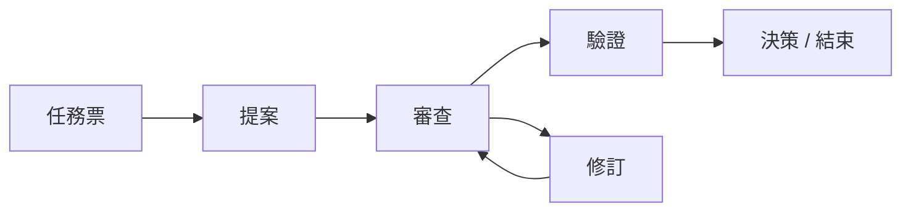

<a id="top"></a>

<h1 align="center">Agent Collaboration Skill</h1>

<p align="center"><strong>適用於 Codex、Claude Code、Cursor 及其他 AI 程式設計代理的跨工具、多代理協作。</strong></p>

<p align="center">
  <a href="LICENSE"></a>
  <a href="#installation"></a>
</p>

<p align="center">
  <a href="README.md">English</a> · <a href="README.zh-CN.md">简体中文</a> · <strong>繁體中文</strong> · <a href="README.fr.md">Français</a> · <a href="README.ko.md">한국어</a> · <a href="README.ja.md">日本語</a>
</p>

<p align="center">
  <a href="#installation">安裝</a> · <a href="#quick-start">快速開始</a> · <a href="#automatic-multi-round-collaboration">自動協作</a> · <a href="#reference">參考資料</a>
</p>

一套不依賴特定廠商的技能與檔案協定，透過共用的 Markdown 和 JSON 檔案，而非廠商專屬服務，讓 AI 程式設計代理與人類參與者進行持久、可追溯的協作。提供 Python CLI、選用的自動喚醒執行程式和本機 Web UI。

| **可追溯的歷史** | **可靠的交接** | **工具自由組合** |
| :--- | :--- | :--- |
| 不可修改的 Markdown 回合，讓決策與審查發現有據可查。 | JSON 訊號、獨立狀態與原子發布，讓交接明確、重複檢查不重複執行。 | 在共用儲存庫中使用 Codex、Claude Code、Cursor 或其他代理。 |

<details>
<summary>為什麼選擇檔案，而不是另一個服務？</summary>

### 為什麼需要這個專案

AI 程式設計工具通常各自保存對話狀態，這使跨工具協作變得脆弱：脈絡需要手動複製，回饋可能遭到覆寫，反覆輪詢還可能重複處理同一則訊息。

本專案提供一套由 Markdown 和 JSON 構成的輕量共用協定：

- 不可修改的 Markdown 回合檔案保留協作歷史；
- 依接收者分別存放的 JSON 訊號通知下一位參與者；
- 每個代理獨立的狀態防止重複處理；
- 穩定的問題發現 ID 讓審查問題能夠跨回合追蹤；
- 原子發布避免訊號指向尚未完成的產物；
- 特定工具的輪詢、掛鉤和排程器不屬於協定本身。

無需廠商 API 或背景服務。

</details>

<a id="installation"></a>

## 安裝

### 環境需求

- 共用的 Git 儲存庫或檔案系統；
- 如需使用選用的 CLI，須安裝 Python 3.9 或更新版本；
- 能讀取 Markdown 和 JSON 的 AI 程式設計工具；
- 喚醒代理的方式：使用隨附的 `collab.py watch` 指令搭配各工具的非互動式 CLI，或使用手動提示、掛鉤或排程工作。

協定本身不會建立背景監控；選用的 `collab.py watch` 執行程式提供這項能力。

### 工具設定

複製儲存庫：

```bash
git clone https://github.com/longligooo/agent-collaboration-skill.git
```

對於原生支援技能的工具，將儲存庫複製或連結至該工具的技能目錄。常見位置包括：

```text
~/.codex/skills/agent-collaboration/
~/.claude/skills/agent-collaboration/
.claude/skills/agent-collaboration/
```

對於 Cursor 或使用專案指示的工具，在專案規則或 `AGENTS.md` 項目中指向 `SKILL.md`。協定只保留一份權威副本。詳見[工具配接器](references/tool-adapters.md)。

<a id="quick-start"></a>

## 快速開始

### 1. 準備規格與任務票

<a id="tickets"></a>

#### 任務票

派工之前，先將人類需求寫成規格和任務票。一輪需求可以拆成多張票，每張票只鎖定一件可獨立驗收的事。沒有對應任務票時，不開始實作，也不開協作討論串。回合保持不可修改；任務票的狀態可以改變。`collab.py` 不解析任務票。詳見[任務票](references/tickets.md)。本儲存庫依照 [`.docs/agents/issue-tracker.md`](.docs/agents/issue-tracker.md) 中的宣告，將任務票存放在 `.scratch/<feature-slug>/` 下。

### 2. 建立協作執行緒

先撰寫規格和任務票，再從目標儲存庫中初始化協作討論串。目標描述中需要寫明該任務票：

下文中的 `/path/to/agent-collaboration` 表示此技能的安裝位置。請在你希望代理進行工作的儲存庫中執行這些指令。

```bash
python /path/to/agent-collaboration/scripts/collab.py init \
  --root . \
  --thread-id config-redesign \
  --topic "Configuration redesign" \
  --objective "Ticket .ai-collab/tickets/config-redesign/issues/01-migration-plan.md: agree on and verify the migration plan" \
  --coordinator lead \
  --participants lead frontend backend
```

`--topic` 是供人閱讀的標題，應使用對話的主要語言概括。中文對話使用中文主題，例如 `--topic "配置改造"`，而 `--thread-id` 仍維持為 `config-redesign`。上方範例使用英文，是因為範例中的對話為英文。

每位新協作者都會收到一則開場提示，告知其在該討論串中使用此技能。人類將提示貼到協作者的對話中；但如果協調者是目前工作階段的子代理，則由發起討論串的代理直接傳達。已經使用此技能的協作者不需要開場提示，人類只需告知其獲派了一個新討論串。

如果專案已宣告任務票根目錄，請在上述路徑中使用該目錄。

### 3. 撰寫第一個回合

建立第一個不可修改的回合範本：

```bash
python /path/to/agent-collaboration/scripts/collab.py new-turn \
  --root . \
  --thread-id config-redesign \
  --author lead \
  --role proposer \
  --kind PROPOSAL \
  --status OPEN \
  --requested-action REVIEW \
  --title "Configuration redesign proposal"
```

### 4. 發布完整回合

填寫產生的 Markdown 檔案，然後發布：

```bash
python /path/to/agent-collaboration/scripts/collab.py publish \
  --root . \
  --thread-id config-redesign \
  --agent lead \
  --to frontend \
  --document .ai-collab/threads/config-redesign/turns/round-0001-from-lead-proposal.md
```

### 5. 檢查接收者的收件匣

接收者使用以下指令檢查自己的收件匣：

```bash
python /path/to/agent-collaboration/scripts/collab.py inspect \
  --root . \
  --agent frontend
```

> [!IMPORTANT]
> 只有 `NEW` 判定應產生回覆。`EMPTY`、`DUPLICATE` 和 `INVALID` 判定不得建立檔案或修改業務程式碼。終止訊號必須依其要求執行確認或結束操作。

<a id="workflow"></a>

## 協作如何流轉

一種審查循環範例；請依任務需要選擇回合類型，而非固定套用流程。



當 Codex、Claude Code、Cursor 或其他程式設計代理需要透過共用儲存庫討論設計、質疑方案、交接實作、審查工作、驗證結果、記錄決策或結束多回合任務時，可以使用本專案。

<details>
<summary>支援的工作流程與範例</summary>

### 支援的工作流程

- 需求與架構討論；
- 提案、質疑與修訂；
- 實作交接；
- 計畫、程式碼與文件審查；
- 獨立驗證；
- 決策、達成共識、取消與結束。

標準回合類型為 `DISCUSSION`、`PROPOSAL`、`CHALLENGE`、`REVISION`、`IMPLEMENTATION`、`REVIEW`、`VERIFICATION`、`DECISION` 和 `CLOSURE`。

典型使用情境：

| 使用情境 | 範例 |
| --- | --- |
| 架構討論 | 讓一個代理提出設計，另一個代理質疑其假設，再做出決策。 |
| 實作交接與程式碼審查 | 交接實作，在多次修訂中持續追蹤審查發現的問題，再驗證修正結果。 |
| 獨立驗證 | 請另一個代理重現測試結果，或依據儲存庫中的證據查核某項結論。 |

</details>

<a id="automatic-multi-round-collaboration"></a>

## 自動多回合協作

如果沒有自動化，每一回合後都需要有人告知各代理「有新訊息等待處理」。`watch` 指令代為完成這件事：它掃描每個代理的收件匣，只要有待處理訊號，就執行接收者的非互動式 CLI（`claude -p`、`codex exec`、`agent -p`、`gemini -p` 等）來完成一個處理週期。每次回覆都會產生下一個訊號，使討論串逐回合推進，直到某個代理發布 `AGREED`、`CLOSED` 或 `CANCELLED`。

```bash
# 每個儲存庫只需執行一次：為每位參與者選擇喚醒指令
python /path/to/agent-collaboration/scripts/collab.py init-wake \
  --root . --bind lead=cursor --bind frontend=claude-code --bind backend=codex

# 開啟討論串並發布第一回合（手動完成或請任一代理完成），
# 然後讓監看程式推動後續回合
python /path/to/agent-collaboration/scripts/collab.py watch \
  --root . --thread-id config-redesign
```

當討論串結束、出現 `STOP` 檔案，或達到回合數、喚醒次數或重試次數上限時，監看程式會停止。代理輸出寫入 `.ai-collab/logs/`。不同機器上的參與者可以透過 `--agents backend --git-sync` 使用 Git 共用討論串。`--git-sync` 只發布 `.ai-collab/threads/`，且只能由人類啟用。除非人類明確要求，否則參與者不提交產品程式碼。無人值守執行前，請檢查產生的 `.ai-collab/wake.json` 權限。設定格式和安全限制詳見[工具配接器](references/tool-adapters.md#automatic-wake-up-with-collabpy-watch)。

<a id="local-web-ui"></a>

## 本機 Web UI

在有人執行以下指令之前，Web UI 不會啟動：

```bash
python scripts/collab.py ui --root .
```

在 Windows、macOS 和 Linux 上，它都會綁定至 `127.0.0.1:23451`。指令會先探測該連接埠。再次執行時，會將目前儲存庫註冊到已經執行中的 UI。開啟 `http://127.0.0.1:23451/`，即可查看所有已註冊專案、各專案的討論串，以及跨專案的各位參與者。頁面不會自動重新整理；請使用「刷新」（重新整理）按鈕。首個版本採用深色介面。只有當人類要求啟動協作後台或 Web UI 時，才啟動它。

執行 `python scripts/collab.py --help` 查看指令選項。

<a id="reference"></a>

## 參考資料

| 閱讀入口 | 用途 |
| :--- | :--- |
| [SKILL.md](SKILL.md) | 代理工作流程與安全規則 |
| [references/protocol.md](references/protocol.md) | 協定與配接器實作 |
| [references/artifact-format.md](references/artifact-format.md) | 回合、訊號、清單與狀態格式 |
| [references/tool-adapters.md](references/tool-adapters.md) | 工具探索與喚醒設定 |
| [references/examples.md](references/examples.md) | 完整協作序列範例 |
| [references/tickets.md](references/tickets.md) | 規格與任務票要求 |

<details>
<summary>工作區格式</summary>

### 工作區格式

每個目標儲存庫都會有一個 `.ai-collab` 工作區：

```text
.ai-collab/
  threads/<thread-id>/
    thread.json
    turns/round-<NNNN>-from-<agent>-<kind>.md
    signals/to-<agent>.json
    state/<agent>.json
```

回合是事實來源，訊號是可替換的通知。每個代理只寫自己的狀態檔案，絕不編輯其他參與者的回合。

使用工作流程前請閱讀 [SKILL.md](SKILL.md)，實作配接器前請閱讀[協定](references/protocol.md)。

</details>

<details>
<summary>CLI 指令</summary>

### CLI 指令

```text
init               建立不可修改的討論串資訊清單
new-turn           建立不會覆寫現有檔案的回合範本
validate-artifact  驗證已完成的回合
inspect            檢查一個代理的收件匣
inbox              代理有郵件時以 0 結束，否則以 1 結束
publish            原子發布回合訊號
acknowledge        將目前訊號標記為已處理
init-wake          為監看程式寫入喚醒設定範本
watch              有待處理訊號時自動喚醒代理
ui                 啟動本機 Web UI，或僅註冊目前儲存庫
```

</details>

<details>
<summary>儲存庫內容</summary>

### 儲存庫內容

```text
SKILL.md                       提供給代理的工作流程說明
agents/openai.yaml             選用的 Codex 介面中繼資料
references/protocol.md         標準協作協定
references/artifact-format.md  回合、訊號、資訊清單與狀態的格式
references/tool-adapters.md    Codex、Claude Code、Cursor 及通用配接器
references/examples.md         協作序列範例
references/tickets.md          規格與任務票格式；派工前必備
.docs/agents/issue-tracker.md   本儲存庫的任務票根目錄
scripts/collab.py              僅使用標準函式庫的協定 CLI
scripts/ui_server.py           本機 Web UI 伺服器
scripts/adapters/              Cursor、Claude Code 和 ChatGPT 的 `inbox` 呼叫程式
ui/                            深色本機 Web UI
tests/test_collab.py           CLI 與協定回歸測試
tests/test_watch.py            自動喚醒（watch）測試
tests/test_inbox.py            共用收件匣查詢與各工具的喚醒指令碼
tests/test_ui.py               本機 Web UI 的儲存庫註冊、檢視與單一程序啟動
```

</details>

<a id="validation"></a>

## 驗證

執行回歸測試套件：

```bash
python -m unittest discover -s tests -v
```

測試涵蓋發布、檢查、確認、重複偵測、終止訊號、不可修改的回合、安全的儲存庫路徑、訊號身分，以及監看程式的無人值守多回合執行（包括其限制和 Git 同步）。

<a id="security-and-scope"></a>

## 安全與範圍

> [!IMPORTANT]
> 要求執行某項協作操作並不代表獲得額外授權。代理仍須遵守使用者的任務範圍，並在執行指令前獨立評估。不要將機密資訊放入回合、資訊清單、訊號或狀態檔案。

<a id="license"></a>

## 授權條款

MIT 授權條款。請見 [LICENSE](LICENSE)。

<p align="right"><a href="#top">返回頂端 ↑</a></p>
